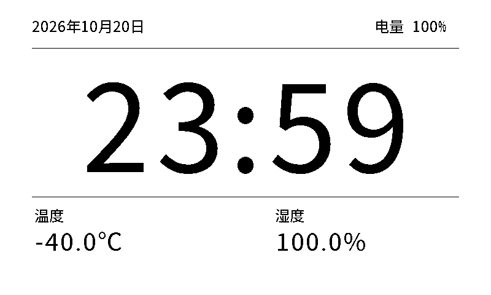
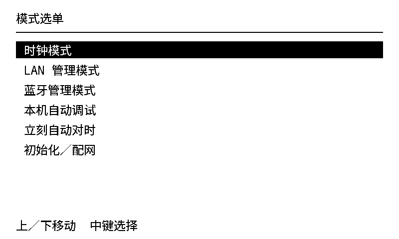

# epaper-clock

Waveshare **ESP32-S3-ePaper-3.97** 节能时钟，ESP-IDF **5.5.2**，16MB Flash / 8MB PSRAM。
设备只加入用户路由器的 **2.4GHz Wi-Fi（STA）**，不开热点。

> 菜单、蓝牙手动设时、LAN 三项全局渲染和 OTA 已实现，并通过 ESP-IDF 5.5.2 完整构建、协议/菜单/绘图/帧编码测试及浏览器模拟。
> **尚未进行实机刷入、BLE/路由器联调、OTA断电回滚或电池电流验收**；不要把软件测试当作实机通过。

- [本地对话疑问与结论：供电、电池、TF、刷新和续航](docs/questions.md)
- [模式与按键规则](docs/interaction.md)
- [三模式状态机](docs/state-machine.md)
- [蓝牙设置协议](docs/clock-control.md)
- [OTA、首次刷入与回滚](docs/ota.md)
- [LAN 全局渲染设置：无灰度／线性灰度／轮廓匹配四灰](docs/rendering.md)
- [电源设置：深睡／PMU 关机、PWR 开机按压阈值](docs/power.md)
- [四灰模拟与算法评估记录](docs/grayscale-study.md)
- [exFAT / FAT32 SD 缓存：现有卡、格式与边界](docs/sd-cache.md)
- [第三方来源与许可](THIRD_PARTY.md)

## 时钟画面



800×480 C 绘图测试预览，数值为测试样例，不是实机照片。
时间使用原生 200px、读数使用原生 40px 字模，离线生成，设备不运行字体引擎。帧统一为 2bpp，各模式的输出与刷新策略见渲染说明。
主页只保留日期、时间、电量和温湿度，不常驻操作提示，也不画分割线。
左右统一留白 64px，日期与电量分别沿两侧对齐；温湿度使用等宽双列，标签和读数各自居中，以留白区分信息层次。

## 三个业务模式

| 模式 | 用途 |
| --- | --- |
| 初始／配网 | BLE 设置 Wi-Fi 和时间；失败或窗口暂停仍留在初始模式，中键可重试 |
| 时钟 | 时钟、日期、温湿度、电量，每日短暂联网校时 |
| 管理 | LAN 网页或 BLE 管理；不是另一套配网实现 |

首次没有完成设置时进入初始化。首次 Wi-Fi 保存后尝试校时，时间无效且 NTP 失败时仍留在初始化，可用蓝牙手动设时。
用户主动选择离线时钟会保留这一选择，不因分钟冷启动反复强制配网。强制初始化不清空 RTC / SD / 整个 NVS。

## 按键和屏幕选单

- **长按中键约 1 秒**：呼出中文选单。上下移动，**短按中键一次就是选择**。
- 时钟 / LAN / BLE / 调试 / 立即对时均直接进入或执行，没有第二次点击。
- **只有初始化**弹额外确认，默认取消。
- **按住上键再 PWR 开机**：最高优先级强制初始化，不弹确认，不受旧 Wi-Fi 配置影响。
- 选当前模式只关闭选单，不重启服务；选单闲置 30 秒收起。诊断和立即对时可以重复执行。
- 默认电池 PMU 关机后拨轮不能唤醒：先用 PWR 开机，时钟保留短暂按键窗口；正常分钟唤醒不额外等这个窗口。可在 LAN 选择 ESP 深睡，GPIO5 中键唤醒后继续长按约 1 秒直接进入菜单，见[电源设置](docs/power.md)。
- 主控运行时长按 PWR 约 4 秒后松手正常关机，显示提示后逐步变白；持续约 10 秒是应急硬关。深睡中须先用中键唤醒，不能保证 PWR 直接唤醒播放动画，详见[电源说明](docs/power.md#pwr-正常关机与渐白动画)。
- BOOT 上电是下载模式，不是管理入口。

下面是原生 C 绘图测试输出的 800×480 菜单预览（不是实物照片）：



菜单有六项：

| 选项 | 行为 |
| --- | --- |
| 时钟模式 | 显示时钟，按日校时 |
| LAN 管理模式 | 连接路由器，提供 HTTP 状态、校时和 OTA |
| 蓝牙管理模式 | Pages 仅设置 Wi-Fi / 手动时间 |
| 本机自动调试 | 显示 Wi-Fi/SSID/IP/NTP、TF 初始化与文件系统、48KB 缓存帧写入/重开读 CRC/数据比较/清理结果；**不写 RTC / 配置**，不把 IO 成功当作硬件局刷验收，结果页中键返回选单 |
| 立刻自动对时 | 立即查询 NTP并写 RTC；失败保留旧时间，完成回时钟 |
| 初始化／配网 | 重新进入初始设置，需要额外确认 |

网络等待中仍处理选单，选择其它动作会中断当前等待并先清理无线服务。屏幕物理刷新期间，独立扫描任务保留按键事件。

## 首次 BLE 设置

HTTPS 配网页：**https://billxc.github.io/epaper-clock/**。
页面通过本固件的加密 `clock-control` 端点设置 Wi-Fi 和时间。

1. 开机进入初始模式，屏幕显示 `PROV_EPAPER_…` 和本次 **6 位数字码**。
2. 新版 Android / 桌面 Chrome、Edge 打开 HTTPS 页面，输入六位码，选择设备。
3. 选择或输入家中 Wi-Fi，提交；只有设备返回“应用配置已保存”的 ACK，页面才报告保存成功。
4. 也可在同一页面手动设置日期时间。输入包含明确 UTC 偏移，可一键填入手机当前时间；写入独立 RTC，不依赖 NTP。
5. 设置完成回时钟；以后更改 Wi-Fi / 时间可从选单进入蓝牙管理。

Pages 不读取手机保存的 Wi-Fi 密码，不向 GitHub 上传凭据，不用浏览器存储保存密码。
使用 Security1（X25519 / PoP / AES-CTR），不降级明文；短码优先易输入，仅面向物理触发、限时、可信近距离设置。
初始模式窗口暂停时按中键重试；蓝牙管理闲置约 5 分钟退出。状态轮询不续期。
iPhone / iPad 普通浏览器通常不支持 Web Bluetooth；可用支持浏览器的电脑/安卓设备。官方配网 App 支持标准 Wi-Fi 配网，但没有本项目自定义的手动时间界面。

## LAN 管理

选单选择 LAN 后，屏幕显示路由器分配的 IP 和固定的 HTTP 管理密码。
首次使用时以硬件随机数生成高强度密码，成功保存到 NVS 后才开启 HTTP；以后进入/退出管理、重启、RTC 分钟唤醒、OTA 恢复及普通/强制初始化均不轮换。无密码重置入口；清除 NVS 或覆盖 NVS 的 USB 安装会丢失它。
在同一可信局域网打开 `http://<屏幕IP>/`，用户名 `admin`，密码不是路由器密码。Basic Auth 保留，HTTP 不加密，仅适用于可信 LAN；密码不会写入串口日志。

- 状态、全局渲染／电源设置、立即校时、固件升级、退出；Wi-Fi 凭据和手动时间只通过加密 BLE 设置。
- 电源设置可选 **PMU 关机／ESP 深睡**及 PWR 开机 **128／512／1000／2000ms**，默认 PMU／1000ms。持久化后由主循环应用。主控运行时 PWR 长按约 4 秒后松手显示关机提示、三帧消隐至白并关闭；10 秒硬件强关始终保留，可跳过动画。深睡整板电流及真实按键唤醒仍待验收。
- 渲染可选 **无灰度／线性灰度／轮廓匹配四灰**，默认无灰度。保存后无需退出 LAN 或重启，设置会保留；时钟、菜单、配网及提示文字统一应用。灰阶实屏效果仍待验收，恢复入口见 [渲染说明](docs/rendering.md)。
- **连续 5 分钟无用户交互返回时钟**。按键、主动网页操作/访问重置计时，自动状态轮询不算。
- 持续操作可保持管理，无总时长上限；升级中暂停闲置退出和模式切换。
- 连接失败有屏幕反馈；每会话最多 3 次尝试，间隔 10 秒。掉线可在预算内重连；用尽后仍可用选单换模式，或闲置退出。
- 管理退出会停止 HTTP 和 Wi-Fi。**USB 时钟也不是常驻 LAN**，不能靠网络唤醒 PMU 关机设备。

## 日常节能与时间

每分钟唤醒 → 检查每日校时 → 无灰度按需挂载 SD 并打开或新建缓存 → 采样/刷新 → 关闭屏幕 ALDO3 → 无灰度成功后写缓存并同步、卸载并释放 SD 主机 → 按保存设置进入 PMU 关机或 ESP 深睡。PMU 使用外部 RTC 定时上电；深睡使用按 RTC 秒数对齐的 timer，另允许中键 GPIO5 唤醒。
USB 供电时主控继续运行，可随时长按中键。无线只在所属任务中开启，不常驻 BLE / LAN。

- 默认 08:00 后每日最多一次自动尝试；失败当天不紧密重试。STA 等待最多 15 秒，NTP 最多 10 秒，均支持菜单中断。
- 手动立即对时不受当天尝试限制。诊断只查询，不写 RTC；手动时间写入后每日校时策略仍有效。
- 无灰度的普通 RTC 分钟冷启动在缓存有效时沿用旧帧 + 新帧局刷，不因本次刚启动就全刷；无有效旧帧、整点/半点、手动进入、改时及显示状态不可靠时仍全刷。两种灰阶使用厂家四灰整屏刷新，不与黑白局刷混用。
- 单色菜单/管理/消息及每次时钟传输前先使缓存失效；仅实际显示成功、没有菜单遮挡的时钟帧才能重新提交。退出菜单全刷恢复背景，必要时下一分钟全刷重建缓存。日志报告缓存读写结果和局/全刷原因，不包含管理凭据。
- SD 直接使用现有 **exFAT** 卡，同一驱动也支持 **FAT32**；无需格式化、重新分区、删除视频或电脑准备工具。使用 SDK 5.5.2 自带 FatFs R0.15，项目内启用 exFAT、heap LFN 和 UTF-8，不修改共享 SDK；4-bit SDMMC 最高 40MHz 不变。
- 设备通过普通文件 API，在已挂载卷根目录排他新建 `epaper-cache.bin` **64KiB 容器**；已有同名文件若大小或头身份不识别就拒绝缓存，不覆盖、不截断。格式为 `EPDCACHE` 版本 1：512 字节头、帧偏移 512、48,000 字节 1bpp 帧和头/帧 CRC，静态 4KiB 分批 I/O。已识别缓存不截断，按 invalid → payload → valid 提交并同步。
- 挂载失败不 format、fdisk 或 repair；无卡、缓存不可用或 CRC 失败均不用旧帧并全刷。显示失败只尝试使已识别缓存头失效，不删除文件。设备不主动修改或删除其他文件，但创建缓存会正常更新目录/分配元数据，不能保证绝对不影响视频；exFAT 无日志，真实掉电仍需硬件验证，重要视频应另行备份。详见 [SD 缓存说明](docs/sd-cache.md)。正常灰阶显示不初始化、挂载或读写 SD；显式自动调试可访问 SD，使正式基准失效后，仅向每次独立命名、排他新建的 `epaper-cache-test-<随机数>-<序号>.bin` 写测试帧，同名文件不覆盖，失败残留不删除且不阻止下一次用新名字测试。支持卡在两次同步 SD 操作之间、无读写时换卡，下次请求自动重挂，初始化/挂载/写入失败重试间隔至少 5 秒，valid=0/CRC 读未命中不阻止同轮重建；无独立 CD GPIO，不承诺实时检测或写中硬拔 exFAT 零损坏，不确定空闲状态时请关机换卡。屏幕断电保留图像，不等同于主控关机。
- Wi-Fi 配置保存为单个版本化 NVS 记录；分钟启动只读配置，不反复写 Flash。
- 提供非阻塞 USB `TIME <UTC epoch>` 备用入口，连接数据线开机后可在主控运行期间使用 `tools/set_time.py`。

已通过 ESP-IDF 5.5.2 完整构建及真实 FatFs exFAT 镜像测试（含重新挂载、CRC、同名文件与其他文件保留、文件系统检查）；实卡时序、掉电、既有视频完整性与功耗仍待验收。

功耗没有实测值，不能保证续航天数。网页校验在手机/电脑，BLE 握手仅在设置，HTTP 认证仅在管理；
主要待测耗电是无线开启时间、冷启动、SD 和刷屏，而非代码行数。

## 构建和首次刷入

```sh
# 已安装 ESP-IDF v5.5.2
idf.py set-target esp32s3
idf.py build
idf.py -p /dev/ttyACM0 flash
```

[Firmware 构建与下载](https://github.com/billxc/epaper-clock/actions/workflows/firmware.yml)：选择最新成功的构建，产物名 `epaper-clock-firmware`。
当前布局为 **7.5MiB × 2 OTA 槽**，尾部保留 896KiB 未分配空间。应用约 **2.725MiB**，每槽剩余约 **4.775MiB**。
产物附带 `partitions.csv`：OTA A 位于 `0x20000`，OTA B 位于 `0x7a0000`，两槽大小均为 `0x780000`。
首次通过 USB 安装完整文件组；日常 LAN OTA 只更新非运行应用槽，不修改分区表。

`Firmware` workflow 运行协议/菜单/绘图测试并编译固件。应用产物 `epaper-clock.bin` 用于 OTA；
`epaper-clock-factory.bin` 是首次 USB 安装合并镜像，不是 OTA 文件。具体地址、保留 NVS 的刷法见 [OTA 文档](docs/ota.md)。
**USB 安装使用同包 bootloader、分区表、OTA 初始数据和应用；不要把独立应用当成合并镜像烧到 `0x0`。**

默认设备时区 `CST-8`（UTC+8），菜单六项是屏幕功能，不是编译配置。
`idf.py menuconfig` → `Clock` 可更改时区、NTP 服务器和自动校时小时。

## 安全与验证边界

HTTP Basic 没有 TLS，只适用于可信 LAN，不开放公网。OTA 校验镜像/芯片/项目和内容完整性，**不是发布者数字签名**。
NVS 未启用 Flash 加密，不防物理读取。已有 Git 历史及作者邮箱按授权保留，新代码不写入真实用户凭据或本机私有路径。
中文位图字库来自 Noto Sans SC，遵守 OFL 1.1；其余许可证见 [THIRD_PARTY.md](THIRD_PARTY.md)。

电源配置沿用官方示例的 AXP2101 接口，官方资料将 PMU 称为 TG28；实物兼容性、具体电源轨和静态电流未独立确认，不适用于任意 ESP32 板。
真实按键手感、墨水屏时序/残影、BLE/GATT/路由器、OTA 断电与回滚、第二次进入服务及电池电流仍须上板验收。
