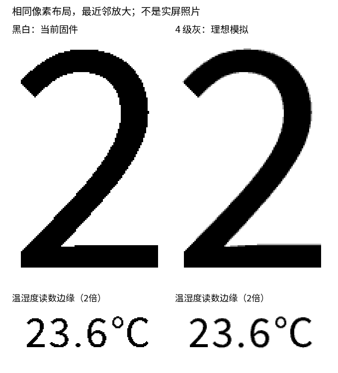
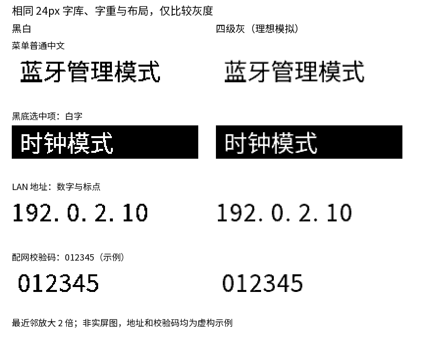
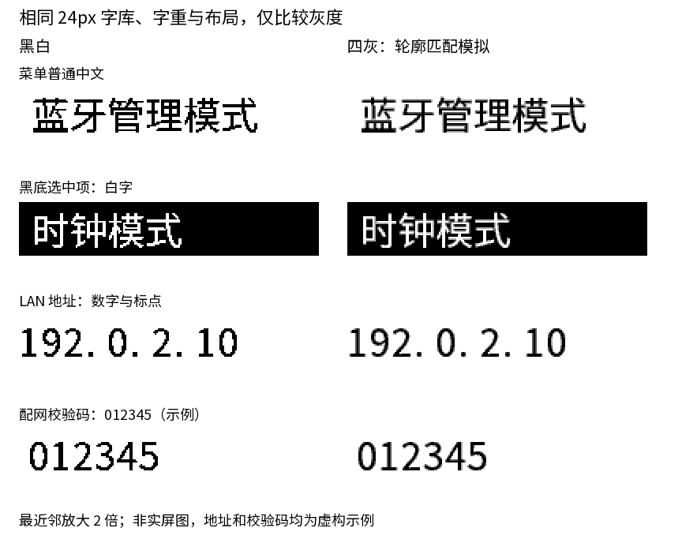

# 四级灰效果模拟与实现评估

**仅模拟与评估，未修改固件渲染、驱动或分钟刷新策略。当前正式固件仍为黑白。**

## 1. 效果

[当前黑白全图](screenshots/clock.png) · [四灰模拟全图](grayscale/gray4.png)



比较图左侧为当前黑白，右侧为四灰；时间局部最近邻放大 3 倍，读数局部放大 2 倍。
不是将黑白图模糊，而是从相同 Noto Sans SC 字体重新提取原生像素覆盖率，再量化为四级。
字号、坐标、布局、黑色主体和白底均保持不变，日期、标签及读数都参与抗锯齿。

- 黑白模拟与现有 C 绘图基线逐像素一致：差异 **0**。
- 四灰仅使用理想亮度 **0、85、170、255**。
- 四灰改变 **3,728 / 384,000 像素，约 0.97%**，主要是一圈边缘过渡；这不是刷新能量的比例，四灰驱动仍走整屏刷新。
- 弧线、斜线和小读数更柔和；大数字主体、布局与分辨率不会因此改变。
- 本图是电脑上的理想灰度，不模拟实际纸面反射、灰度非线性、温度、残影或闪屏。实屏收益可能更小；细小笔画也可能变淡，需要实物标定。

### 其他界面的 24px 文字



同一套字体、同一字号/字重和位置，只改变覆盖率量化；没有改变原始字形尺寸或模糊图片。对比裁剪的两侧统一最近邻放大 2 倍，菜单和提示页布局沿用现状。
菜单黑白模拟与已有 C 绘图基线逐像素一致；配网和 LAN 提示页按相同 `screen_render()` 模板模拟，内容是虚构示例，未分别执行 C 基线验证。

| 电子纸界面 | 黑白全图 | 四灰全图 |
| --- | --- | --- |
| 模式菜单，包括反白选中项 | [黑白](grayscale/menu-mono.png) | [四灰](grayscale/menu-gray4.png) |
| 初始化／蓝牙配网提示 | [黑白](grayscale/provision-mono.png) | [四灰](grayscale/provision-gray4.png) |
| LAN 地址／登录提示 | [黑白](grayscale/lan-mono.png) | [四灰](grayscale/lan-gray4.png) |

24px 中文、数字和反白字的边缘改善比大字更显眼，但笔画会显得略轻；实屏需要兼顾抗锯齿与对比度。
前述 0.97% 只描述时钟场景的全屏像素差异，不代表其他页面，也不代表字体笔画内的变化比例。
IP 使用文档示例网段，设备名、密码及校验码均为虚构；不是设备的默认凭据。

**范围修正：后续若提供 LAN 切换，应是全局“黑白／四灰显示模式”，统一控制电子纸上所有页面与文字，而不是只控制时钟。**
浏览器中的 LAN 配置网页由浏览器进行字体抗锯齿，不受电子纸灰阶模式约束；本节比较的是设备屏幕上的 LAN 提示页。

### 按算法计算：轮廓匹配四灰候选

上面的图片为线性四灰基线。本节为新的计算候选，**不是 FreeInk 的 Gamma 参数或波形复现，也不是本屏的实测标定值**。
参考的是 2bpp 数据组织与黑白／四灰共用思路；曲线由本项目已有单色阈值推导。

[主页左右全图](grayscale/ink-match/clock-side-by-side.png) · [菜单左右全图](grayscale/ink-match/menu-side-by-side.png)



对比图均为左侧当前黑白、右侧候选四灰。外层标题不属于设备画面；全图每侧保持 800×480，建议打开原图按 100% 查看，避免浏览器缩放掩盖差异。
[单独查看四灰主页](grayscale/ink-match/gray4.png) · [单独查看四灰菜单](grayscale/ink-match/menu-gray4.png)。

计算方法：

```text
a = 字形原始覆盖率 / 255
T = 当前单色判定阈值
γ = ln(0.5) / ln((T - 0.5) / 255)
q = round(3 × a^γ)                 # 2bit 墨量，0..3
黑字白底：像素亮度 = 255 - 85 × q
白字黑底：像素亮度 = 85 × q
```

- 现有 24px UI 字库阈值为 96，推导 γ≈**0.705754**；200px/40px 数字阈值为 128，对应 γ=**1**。
- 阈值中减 0.5 是为了把边界放在离散覆盖率的 95/96（或127/128）之间，不是额外改变字重或字号。
- 小字中间覆盖率稍增强，使灰边更接近原有笔画饱满度；先处理覆盖率，再按前景/背景混合，因此反白也能保持清晰。
- 字模仅需存四档；黑白模式取阈值即可，不需要设备实时计算幂函数。离线穷举两类字体的全部 256 个覆盖率值，均与原单色判定一致。
- 时钟、菜单、配网及 LAN 四个示例从四灰重新二值化后，与对应黑白模拟的差异均为 **0 像素**；其中时钟和菜单也已对照原 C 图验证。
- 该性质证明当前示例的单色兼容，不代表四灰已在物理屏上达到最佳效果。实际四档反射亮度、温度、残影仍需标定；字体叠加灰色背景等新场景也需单独验证。

复现线性基线或本节候选：

```sh
NODE_PATH="$(npm root -g)" node tools/simulate_grayscale.cjs FONT.ttf OUTPUT_DIR
NODE_PATH="$(npm root -g)" node tools/simulate_grayscale.cjs FONT.ttf OUTPUT_DIR --ink-match
```

使用与现有字库相同的 Noto Sans SC 输入，SHA256 及 OFL 来源见生成脚本和 [许可](../tools/OFL-NotoSansSC.txt)。
脚本针对当前参考场景，若布局、字体或测试数据改变，需同步更新；基线不一致时不会生成误导性的对比图。

## 2. 厂家驱动支持

已明确许可的 [Waveshare 3.97 驱动](https://github.com/waveshareteam/e-Paper/blob/a794fbc39656b0f93938d1ffb3fdc77eaed9e9fc/E-paper_Separate_Program/3in97_e-Paper/Arduino_R4/EPD_3in97.cpp)
提供 `EPD_3IN97_Init_4GRAY()`、`EPD_3IN97_Display_4Gray()` 和对应刷新函数。
板型官方 ESP-IDF 示例也提供 `EPD_SIZE_4GRAY=96000` 与四灰显示路径。

因此有板型对应的**原生四灰**实现依据，不是通过黑白抖动伪装灰度，也不是仅凭两个 RAM 平面推断支持。
但本项目的精简端口目前没有移植这些函数，实机灰阶质量、刷新时长和模式切换仍未验证。

同款板已有 FreeInk SDK 实测支持；本项目只参考其灰阶编码、刷新基准与恢复算法，不引入 SDK 或迁移框架，详见 [FreeInk 同款板算法参考](freeink-evaluation.md)。

## 3. 代码与资源改动

不是一个开关，需要贯通像素、字库、驱动及恢复路径；业务模式、按键、BLE、NTP 和 OTA 逻辑不必因此新增功能。

| 部分 | 必要工作 |
| --- | --- |
| 字库与绘图 | 离线生成时钟及通用 UI 字体的四级覆盖率，增加 2bpp 像素写入，包含黑底白字；现有 1bpp 字模无法恢复已丢失的边缘灰度 |
| 屏幕端口 | 移植厂家四灰初始化、两 RAM 平面编码和专用刷新；复用现有批量 SPI，不照搬上游逐字节发送的慢路径 |
| UI 显示与恢复 | 全局选择统一作用于时钟、菜单、配网、LAN 提示和结果页；切换时重新渲染并全刷，不能复用旧格式历史帧 |
| 分钟更新与缓存 | 四灰整屏刷新不直接复用当前黑白局刷；缓存需区分格式或版本，不能把 2bpp 数据写入现有 1bpp 缓存 |
| 验证 | 首次显示、连续分钟更新、菜单往返、断电恢复和残影；不能只看编译通过 |

**规模为中等改动，预计数百行手写接线/转换/测试代码，另加生成字模；不是重写整个项目。**
估计不含实机波形与残影调试，最终以实现方案为准。

- 帧缓冲：黑白 **48,000 字节/帧**，四灰 **96,000 字节/帧**。
- 时分和读数字模目前约 19KB。用四灰字模替换约增加 **20KB 量级**；若同时保留独立黑白与四灰两套，新增约 **40KB 量级**，需生成后测量。
- 全局方案需要覆盖通用中文字库，不再只是数字字模。现有 6,938 字的 1bpp 位图＋索引为 513,412 字节；同尺寸 2bpp 为 1,012,948 字节，直接替换净增 499,536 字节（约 0.476MiB，未计可能新增灰边）。
- 建议研究共享一套 2bpp 字库、黑白模式按阈值绘制，避免两份完整中文资源；量化阈值与字重需要校准，不能直接承诺共享后保留所有旧黑白像素。
- 若保留独立黑白字库并新增完整四灰字库，则仅通用 UI 就新增约 0.97MiB。粗估应用可能接近 2.7–2.8MiB；共享字库方案约 2.2–2.3MiB。两者仍在现有 3MiB 槽内，但这些是资源估算，不是新增固件的实编尺寸。
- 当前 8MiB PSRAM 和 3MiB 应用槽有空间；主要难点是刷新与恢复的一致性，不是内存容量。
- 四灰全刷不依赖上一幅灰阶图，未必需要把所有缓冲和 SD 读写机械翻倍；是否重构缓存应另行决定，不能提前把潜在节电算作既得收益。

## 4. 电耗：不能按位深推断翻倍

### 保持画面

稳定后仍可关闭屏幕电源和主控。灰度画面不需要像 LCD 那样持续供电，保持阶段没有必然新增的持续电耗。

### 每次更新

当前 `app_ui_present_clock()` 在普通分钟更新中实际执行：

```text
黑白初始化 → 恢复旧帧的局刷 → 新帧局刷 → 断电
```

两次均传输完整的 48,000 字节，合计 **96,000 字节、两次刷新激活**；半小时等条件另有全刷。

厂家四灰整屏路径则将 96,000 字节 2bpp 图编码到两组 48,000 字节的 RAM，合计也是 **96,000 字节**，
随后执行四灰刷新。**缓存位深翻倍，不等于当前路径的 SPI 字节数翻倍，更不等于整机电耗翻倍。**

关键未知数是四灰波形所需的能量、持续时间，以及相对当前两次局刷的整机唤醒时长差。
四灰可能更耗电，但目前不能断言一定更高或给出倍率；若单次四灰全刷短于两次黑白局刷的总耗时，也可能不增加。
现有驱动没有足以计算这些量的电流或 BUSY 时长实测数据。

### 敏感性示例，不是功耗预测

若比较区间的电池端平均电流相近，每分钟更新一次：

```text
每日增量电量 ≈ 0.4 × 平均电流(mA) × 每次新增时间(s)
```

仅用**假设的 80mA 电池端整机电流**举例：

| 每次额外唤醒时间 | 每日额外电量 |
| --- | --- |
| 0.2 秒 | 6.4mAh |
| 0.5 秒 | 16mAh |
| 1 秒 | 32mAh |

这不是本板测量值，也不是在预测四灰会慢多少。若电流不同，应比较完整积分电量；
不能把 USB 端 mAh 直接当成电池端 mAh。最终还要计入当前半小时全刷、初始化及缓存策略的差异。

## 建议

如果采用双显示模式，应覆盖整套电子纸 UI，不再只给时钟增加灰阶。
全局灰阶下，菜单每次移动选中项也会涉及灰阶刷新，实际响应与闪烁需要验证；不能仅依据静态截图判断。
日常电耗仍主要取决于分钟时钟刷新，菜单/配网/管理页的额外耗电取决于使用频次，不能简单把它们按每分钟刷新来算。

四灰有真实支持依据，视觉上值得试，尤其是 24px 界面文字；但不能用模拟图直接换算续航。
建议先做一次独立四灰显示 A/B 验证，比较同一画面的观感、残影、BUSY 时长及电池端从唤醒到关机的积分电量，
再决定是否改成每分钟四灰。保持现有黑白方案可回退，不先假定四灰局刷或“灰阶背景＋黑白分钟局刷”可行。
