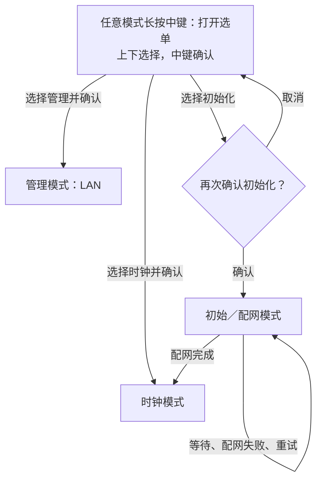

# 目标交互：三个业务模式 + 统一屏幕菜单

**状态：设计约定，尚未修改固件实现。**当前代码行为见 [现状状态机](state-machine.md)。

业务模式只保留三个：

1. **初始／配网模式**：通过 BLE 设置 Wi-Fi；等待、失败、重试都留在这个模式内。
2. **时钟模式**：显示时钟和温湿度，包含定时联网校准动作。
3. **管理模式**：加入已保存的局域网，提供 HTTP 管理。

## 按键规则

| 场景 | 操作 | 结果 |
| --- | --- | --- |
| 任意业务模式 | 长按中键 | 呼出屏幕模式选单 |
| 选单已打开 | 上 / 下 | 移动选中项，不立即切换 |
| 选中时钟或管理 | 中键短按 | 确认进入所选模式 |
| 选中初始化／配网 | 中键短按 | 打开额外确认框，不直接进入 |
| 初始化确认框 | 上 / 下 | 选择「取消」或「确认」，默认取消 |
| 初始化确认框 | 中键短按 | 取消则回选单；确认才进入初始／配网模式 |
| 选单外 | 上 / 下、中键短按 | 不承担原先提议的模式切换快捷键，统一由选单选择 |

长按阈值、选单闲置收起时间在实现时统一确定；不增加必须记忆的组合按键。
PWR 继续承担硬件开关机，不将开关机当作第四种业务模式。

## 简图

**选单和确认框只是 UI 层，不是第四、第五种业务模式。**
只移动选中项不退出原模式，确认后才执行切换；选中当前模式不应重启该模式。

## 初始化与失败的含义

- 这里的「初始化」先指进入 BLE 配网／重新配置 Wi-Fi，**不是未经定义的全盘恢复出厂**。
- 不擅自清除 RTC、SD 卡或所有 NVS。若以后需要恢复出厂，应另行明确清除范围和确认文案。
- 进入配网不立即丢弃旧 Wi-Fi；候选配置验证成功后才更新。
- 配网失败留在初始模式，不自动跳时钟或管理。BLE 等待窗口可因节能暂停，但业务模式不变；可在屏幕提供重新开启配网入口。
- 长按中键应由统一按键处理覆盖三个模式，不能被 BLE／HTTP 阻塞函数吞掉。
- 电池 PMU 关机时拨轮无法直接唤醒，需 PWR 上电后再操作菜单；这是供电约束，不是新模式。

## 与当前实现的差异

当前代码仍有直接按上键重配、按中键进入管理、部分失败返回时钟等行为，尚无这套屏幕选单。
本文件替代之前提议的多个独立快捷键方案；它是后续实现目标，不代表已有固件已经支持。
LAN 是否在时钟模式保持可访问，仍是独立的网络／供电策略，不由「选单」本身解决。
