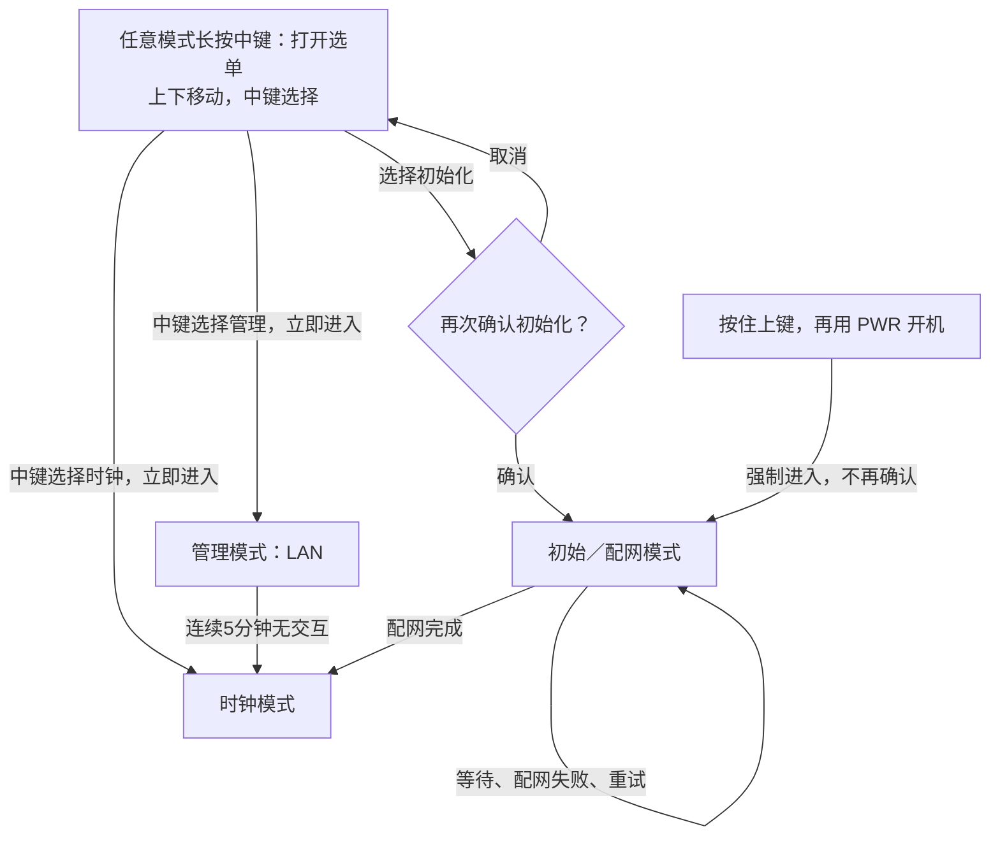

# 目标交互：三个业务模式 + 统一屏幕菜单

**状态：设计约定，尚未修改固件实现。**当前代码行为见 [现状状态机](state-machine.md)。

业务模式只保留三个：

1. **初始／配网模式**：通过 BLE 设置 Wi-Fi；等待、失败、重试都留在这个模式内。
2. **时钟模式**：显示时钟和温湿度，包含定时联网校准动作。
3. **管理模式**：加入已保存的局域网，提供 HTTP 管理；连续 5 分钟无用户交互，自动回到时钟模式。

## 按键规则

中键短按统一称为「选择」，不是需要再按一次的「确认键」。时钟和管理只点一次即进入，
**只有初始化有额外确认框**。

| 场景 | 操作 | 结果 |
| --- | --- | --- |
| 开机时 | 按住上键，再用 PWR 开机 | 强制进入初始／配网模式，绕过选单及二次确认 |
| 任意业务模式 | 长按中键 | 呼出屏幕模式选单 |
| 选单已打开 | 上 / 下 | 移动选中项，不立即切换 |
| 选中时钟或管理 | 中键短按一次 | 立即进入所选模式，无额外确认步骤或弹窗 |
| 选中初始化／配网 | 中键短按 | 打开额外确认框，不直接进入 |
| 初始化确认框 | 上 / 下 | 选择「取消」或「确认」，默认取消 |
| 初始化确认框 | 中键短按 | 取消则回选单；确认才进入初始／配网模式 |
| 选单外 | 上 / 下、中键短按 | 不承担原先提议的模式切换快捷键，统一由选单选择 |

长按阈值、选单闲置收起时间在实现时统一确定。普通模式切换统一通过选单；
仅保留「按住上键开机」作为强制初始化入口，优先于普通启动路由，不受已有 Wi-Fi 配置影响。
PWR 继续承担硬件开关机，不将开关机当作第四种业务模式。

## 简图

**选单和确认框只是 UI 层，不是第四、第五种业务模式。**
只移动光标不退出原模式；中键点选时钟或管理即执行切换，不再要求第二次点击。
初始化是唯一例外，需要在额外确认框中选择后才进入；选中当前模式不应重启该模式。

## LAN 管理闲置退出

- 进入管理模式时开始计时；最后一次用户交互后连续 **300 秒** 无交互，自动切回时钟模式。
- 有效按键操作、已认证的主动网页操作重置计时；包括呼出选单、移动光标、点击选择等交互。
- 后台状态轮询、定时刷新和网络保活不算用户交互，不能让管理模式一直续期。
- 到时关闭 HTTP 管理服务和本次管理使用的 Wi-Fi 连接，恢复时钟画面；不清除 Wi-Fi 配置。
- 目标仅以闲置时间自动退出，不沿用当前代码额外的 15 分钟总时长限制；持续操作可以保持管理。
- 这条规则只适用于 LAN 管理模式，不改变「配网失败留在初始模式」的约定。

## 初始化与失败的含义

- 这里的「初始化」先指进入 BLE 配网／重新配置 Wi-Fi，**不是未经定义的全盘恢复出厂**。
- 不擅自清除 RTC、SD 卡或所有 NVS。若以后需要恢复出厂，应另行明确清除范围和确认文案。
- 强制入口只绕过普通启动路径和菜单确认，不扩大初始化的数据清除范围；配网失败同样留在初始模式。
- 进入配网不立即丢弃旧 Wi-Fi；候选配置验证成功后才更新。
- 配网失败留在初始模式，不自动跳时钟或管理。BLE 等待窗口可因节能暂停，但业务模式不变；可在屏幕提供重新开启配网入口。
- 长按中键应由统一按键处理覆盖三个模式，不能被 BLE／HTTP 阻塞函数吞掉。
- 电池 PMU 关机时拨轮无法直接唤醒，需 PWR 上电后再操作菜单；这是供电约束，不是新模式。

## 与当前实现的差异

当前代码已有开机采样上键、触发 BLE 重配的路径，这个入口保留；但普通按键仍会直接进入重配／管理，
且部分失败会返回时钟，尚无这套屏幕选单和完整的初始模式停留行为。
当前 HTTP 已有 5 分钟闲置退出，但没有将统一按键交互纳入同一个计时器，且仍有额外 15 分钟总时长限制，需按上述目标调整。
本文件替代之前提议的多个运行中独立快捷键方案；它是后续实现目标，不代表已有固件已经全部支持。
按本目标，管理闲置退出后不会继续提供常驻 HTTP；时钟模式的联网校准按独立的节能策略执行。
