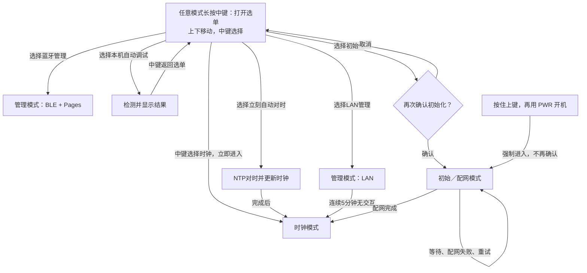

# 三个业务模式 + 统一屏幕菜单

**状态：已实现，并通过完整构建和软件测试，尚待实机验收；最新固件见 [项目 README](../README.md#构建和首次刷入)。**流程见 [状态机](state-machine.md)，升级见 [OTA 说明](ota.md)。

业务模式只保留三个：

1. **初始／配网模式**：通过 BLE 设置 Wi-Fi；等待、失败、重试都留在这个模式内。
2. **时钟模式**：显示时钟和温湿度，包含定时联网校准动作。
3. **管理模式**：分为 LAN 管理和蓝牙管理两个入口；LAN 管理连续 5 分钟无用户交互，自动回到时钟模式。

## 屏幕菜单

| 选项 | 类型 | 选择后的行为 |
| --- | --- | --- |
| 时钟模式 | 模式 | 立即进入时钟 |
| LAN 管理模式 | 管理入口 | 连接局域网，开启 HTTP 管理 |
| 蓝牙管理模式 | 管理入口 | 通过 GitHub Pages + BLE，仅设置 Wi-Fi 或手动设置时间 |
| 本机自动调试 | 一次任务 | 自动检查 Wi-Fi/LAN、测试 NTP、在屏幕逐项显示结果 |
| 立刻自动对时 | 一次任务 | 查询 NTP，成功后写入时钟；完成后返回时钟模式 |
| 初始化／配网 | 模式入口 | 弹出额外确认框，选择确认后才进入 |

菜单选项不等于顶层业务状态。LAN / 蓝牙是管理的两种方式；自动调试、立刻对时是任务，
不为每个检测步骤新增业务模式。除初始化外，短按中键选择一次就进入或执行。

## 按键规则

中键短按统一称为「选择」，不是需要再按一次的「确认键」。非初始化项只点一次即进入或执行，
**只有初始化有额外确认框**。

| 场景 | 操作 | 结果 |
| --- | --- | --- |
| 开机时 | 按住上键，再用 PWR 开机 | 强制进入初始／配网模式，绕过选单及二次确认 |
| 任意业务模式 | 长按中键 | 呼出屏幕模式选单 |
| 选单已打开 | 上 / 下 | 移动选中项，不立即切换 |
| 选中非初始化项 | 中键短按一次 | 立即进入所选模式或执行任务，无额外确认步骤或弹窗 |
| 选中初始化／配网 | 中键短按 | 打开额外确认框，不直接进入 |
| 初始化确认框 | 上 / 下 | 选择「取消」或「确认」，默认取消 |
| 初始化确认框 | 中键短按 | 取消则回选单；确认才进入初始／配网模式 |
| 选单外 | 上 / 下、中键短按 | 不承担原先提议的模式切换快捷键，统一由选单选择 |

中键长按阈值约 1 秒，按键消抖约 40ms；长按释放不再产生短按选择。
选单无操作 30 秒收起，后台任务完成不会立即吞掉仍在操作的选单。普通模式切换统一通过选单；
仅保留「按住上键开机」作为强制初始化入口，优先于普通启动路由，不受已有 Wi-Fi 配置影响。
PWR 继续承担硬件开关机，不将开关机当作第四种业务模式。

## 简图

**选单和确认框只是 UI 层，不是第四、第五种业务模式。**
只移动光标不退出原模式；中键点选时钟或管理即执行切换，不再要求第二次点击。
初始化是唯一例外，需要在额外确认框中选择后才进入；选中当前模式不应重启该模式。

## 本机自动调试

- 自动连接已保存的 Wi-Fi，显示 LAN 基本信息，至少包括 SSID、IP 地址。
- 实际发起 NTP 查询并检查响应，逐项显示「成功 / 失败 / 未执行」及简要原因；不把“能连路由器”当成“NTP可用”。
- 即使 NTP 失败，也保留并显示已经取得的 LAN 信息。没有 Wi-Fi 配置时明确显示未配置，而不是静默失败。
- 这是诊断任务，**只测试和显示结果，不自动改 Wi-Fi 配置或 RTC 时间**。
- 结果页按中键返回选单。以后增加诊断项目时继续追加结果项，不增加顶层模式。

## 蓝牙管理模式

- 使用现有 GitHub Pages HTTPS 页面连接设备 BLE；连接后的业务功能仅有：**Wi-Fi 设置、手动设置时间**。
- Wi-Fi 设置复用初始化／配网能力，候选网络验证成功后才保存；初始化仍遵守失败留在初始模式的规则。
- 手动时间由页面输入并写入 RTC，回到时钟界面时显示新时间；不依赖 NTP 能否访问，也不因此自动切换模式。
- Pages 保留必要的选择设备、校验码与连接状态入口，但不增加 LAN 管理、NTP 自动调试等业务面板。
- 初始模式和蓝牙管理共享配网／手动设时能力，不维护两套配置实现。

## 立刻自动对时

- 中键选择后立即使用已保存的 Wi-Fi 连接 NTP，不弹第二次确认，也不受当天自动尝试次数限制。
- 成功时将结果写入 RTC 并刷新时钟，不只是更新网页或临时系统时间。
- 失败时保留原 RTC 时间并显示失败；任务完成后同样回到时钟模式，不停留在额外模式。
- 与自动调试区分：调试只是查询和展示；这个任务才执行自动校时写回。

## LAN 全局渲染设置

LAN 网页可选择无灰度／线性灰度／轮廓匹配四灰，影响全部电子纸页面和文字，不新增业务模式。默认无灰度，保存后保留，无需重启或退出 LAN；由 UI 任务安全刷新，保存后立即选其他业务也会带入新设置。
灰阶属于待实机验收功能；按住上键 PWR 开机的强制初始化入口同时恢复无灰度，普通菜单进入初始化不重置显示选择。详细行为见 [渲染说明](rendering.md)。

## LAN 管理闲置退出

- 进入管理模式时开始计时；最后一次用户交互后连续 **300 秒** 无交互，自动切回时钟模式。
- 有效按键操作、已认证的主动网页操作重置计时；包括呼出选单、移动光标、点击选择等交互。
- 后台状态轮询、定时刷新和网络保活不算用户交互，不能让管理模式一直续期。
- 到时关闭 HTTP 管理服务和本次管理使用的 Wi-Fi 连接，恢复时钟画面；不清除 Wi-Fi 配置。
- 目标仅以闲置时间自动退出，不沿用当前代码额外的 15 分钟总时长限制；持续操作可以保持管理。
- 这条规则只适用于 LAN 管理模式，不改变「配网失败留在初始模式」的约定。

## 初始化与失败的含义

- 这里的「初始化」先指进入 BLE 配网／重新配置 Wi-Fi，**不是未经定义的全盘恢复出厂**。
- 不擅自清除 RTC、SD 卡或所有 NVS。若以后需要恢复出厂，应另行明确清除范围和确认文案。
- 强制入口只绕过普通启动路径和菜单确认，不扩大初始化的数据清除范围；配网失败同样留在初始模式。
- 进入配网不立即丢弃旧 Wi-Fi；候选配置验证成功后才更新。
- 配网失败留在初始模式，不自动跳时钟或管理。BLE 等待窗口可因节能暂停，但业务模式不变；可在屏幕提供重新开启配网入口。
- 长按中键应由统一按键处理覆盖三个模式，不能被 BLE／HTTP 阻塞函数吞掉。
- 电池 PMU 关机时拨轮无法直接唤醒，需 PWR 上电后再操作菜单；这是供电约束，不是新模式。

## 实现说明与边界

- 原先运行中上键直接重配、中键直接进 LAN 的快捷键已替换为统一选单；开机上键强制初始化保留。
- 正常 PWR 开机默认时钟，首次未完成设置则初始化；手动时钟首屏刷新后约 5 秒可操作，普通 RTC 分钟唤醒不额外等待。
- 初始模式窗口暂停后中键重试，不自动退时钟。蓝牙管理闲置约 5 分钟退出；两者复用同一 BLE 服务。
- USB 时间命令改为非阻塞处理，不再占用开机 10 秒；蓝牙手动时间为主要无 NTP 设置入口。
- LAN 会话最多三次连接尝试，间隔十秒；失败有屏幕提示，仍可打开选单。按键和主动网页访问续期，状态轮询不续期。
- OTA 是 LAN 内任务，不是新增业务模式；上传/校验/重启期间暂停闲置退出及模式切换，详见升级文档。
- 管理退出后不会继续提供常驻 HTTP；时钟只按校时任务短暂联网。PMU 关机仍不能靠拨轮或网络唤醒。
- 上述是实现行为，真实按键/屏幕/蓝牙/OTA 尚未上板验收，不能把代码和单测当成硬件成功。
