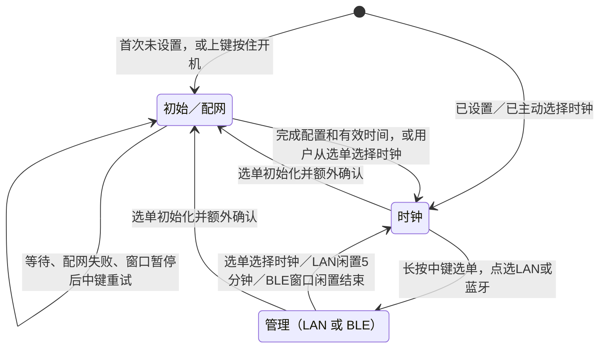

# 三个业务模式的状态机

本版已实现下面的模式与交互，并通过 ESP-IDF 5.5.2 完整构建和软件测试，**不代表已通过实机验收**。最新固件见项目 README；全局渲染模式是显示配置，不新增业务状态，见 [渲染说明](rendering.md)。
菜单项包含模式入口及一次任务，不把网络连接步骤、选单、确认框拆成新的业务模式。

## 按键驱动

长按中键约 1 秒打开选单 → 上下移动 → 中键短按一次执行。
只有初始化多一次确认，默认取消。按住上键再 PWR 开机强制初始化，不再确认。
选当前模式只收起选单，不重启；诊断/立即对时可重复执行。选单闲置 30 秒收起。

按键由独立扫描任务消抖并排队，UI 主任务处理、绘图。联网等待按 100ms 切片处理选择事件，
切换先取消等待并清理当前服务，不让 HTTP 或 BLE 的阻塞循环吞掉选单。
屏幕本身刷新时仍有硬件延迟，不把“按键事件被记录”说成“墨水屏可瞬时刷新”。

## 模式内部行为

| 模式 / 任务 | 内部规则 |
| --- | --- |
| 初始模式 | Wi-Fi 候选连接失败不写配置，仍留初始；BLE 暂停后中键重开。手动先设时不会在未配置Wi-Fi时提前结束首次设置。 |
| 时钟模式 | 每分钟更新，默认每日08:00后一次自动校时；失败当天不紧密重试。无有效首次时间时留初始，可 BLE 手动设时。 |
| LAN管理 | Wi-Fi连接与HTTP启动失败有屏幕提示，最多3次/间隔10秒；掉线在预算内重连。五分钟无真实交互回时钟，无15分钟总上限。 |
| BLE管理 | 与初始共用安全端点；仅 Wi-Fi和手动时间，可重复设置。状态查询不续期，约5分钟闲置回时钟。 |
| 自动调试 | 依次检查Wi-Fi、LAN信息、NTP响应，保留逐项结果；不写RTC／配置，结果页中键回选单。 |
| 立刻自动对时 | 查询NTP并写RTC；失败保留旧时间并提示；结束回时钟，不增加业务模式。 |
| OTA | LAN内任务。流式写非运行槽，升级中暂停模式切换和闲置退出；重启验证/回滚后恢复LAN窗口。 |

业务入口由 `main/main.c` 组织，选单/按键纯模型为 `main/menu_model.c`；UI单独持有屏幕。
LAN / BLE / 网络 / OTA 各自负责资源生命周期，通过 `app_poll()` 和待处理动作交接。
详见 [交互说明](interaction.md)、[BLE协议](clock-control.md)、[OTA](ota.md)。

## 网络成功与保存成功

BLE的 Connected/IP只是联网验证，`clock-control` 的 `wifi_saved` ACK才是本次配置已写入应用记录。
配置保存改为单个版本化NVS blob；旧键只读兼容，不在分钟启动时反复迁移。
初始模式成功ACK后再结束BLE；网页断开不冒充保存成功。重配前由服务主循环复位SDK状态，回调不执行NVS/屏幕/manager操作。

## 供电是策略，不是第四种模式

- 正常电池分钟更新后：关闭屏幕ALDO3、卸载SD、设置RTC闹钟、PMU关机。
- 手动PWR进入时钟：首屏完成后约5秒可操作；**普通RTC分钟启动不增加这个等待，也不每次全刷**。
- USB时钟：CPU继续运行并检查按键，但不常驻LAN；无线只属于当前业务。
- 屏幕关电仍保留图像；LAN在线不要求屏幕一直通电。
- PMU关机后拨轮与网络无法唤醒，只能RTC/PWR重新上电。用户主动选择离线时钟的完成标记会保留。

## OTA特殊启动

待确认新应用先经过本地检查点：RTC总线/本地初始化及带看门狗的首次显示刷新。
标记有效必须在正常分钟关机之前；确认失败请求回滚，回滚也失败则停在USB恢复提示。
不把Wi-Fi离线、NTP失败、日期未设置或无可选SD当成坏固件。
新版本或旧版本恢复后临时提供LAN窗口，保留本次HTTP凭据，网页根据boot ID与升级状态确认结果。

## 验证边界

协议单测和浏览器模拟已覆盖部分路径；新本地C测试用于按键/选单与真实位图绘制边界。
ESP-IDF完整编译、原生C按键模型及位图绘制边界已通过CI。真实按钮/墨水屏、BLE、LAN断线、重复进入及OTA掉电/回滚仍需验收。

早期原型的四张细分图保留在 `diagrams/`（基线524453e），仅供历史审计，**不代表本版菜单流程**。
本版以这张三模式图及交互文档为准，不再用旧原型详细图作为用户操作指南。
