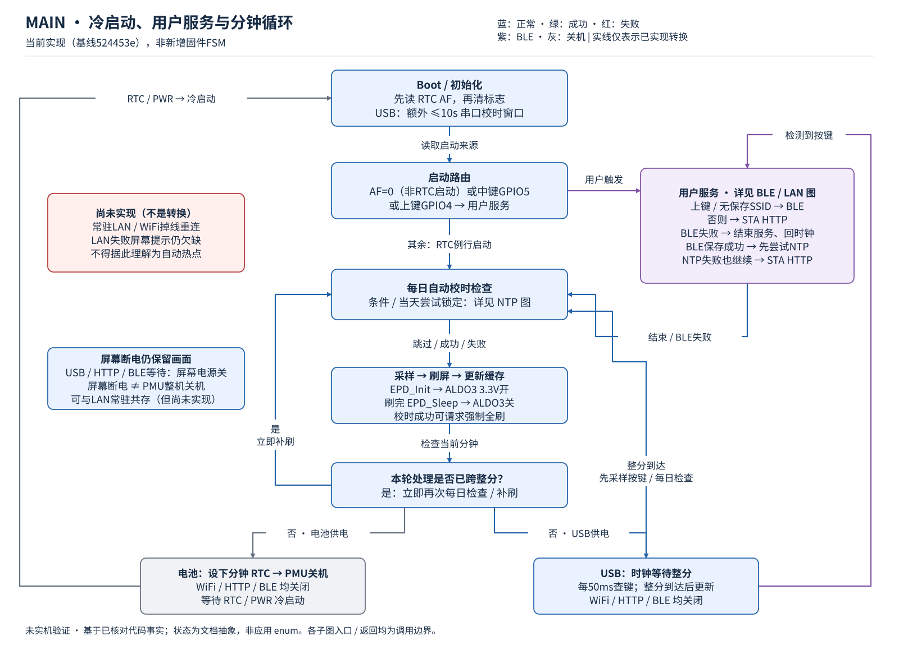
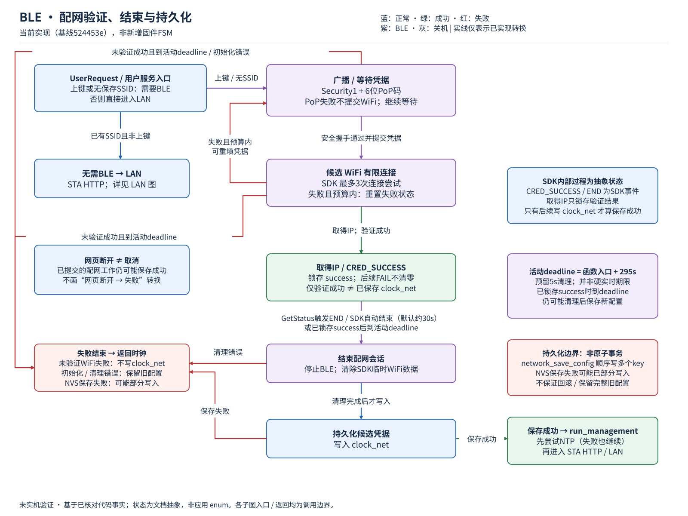
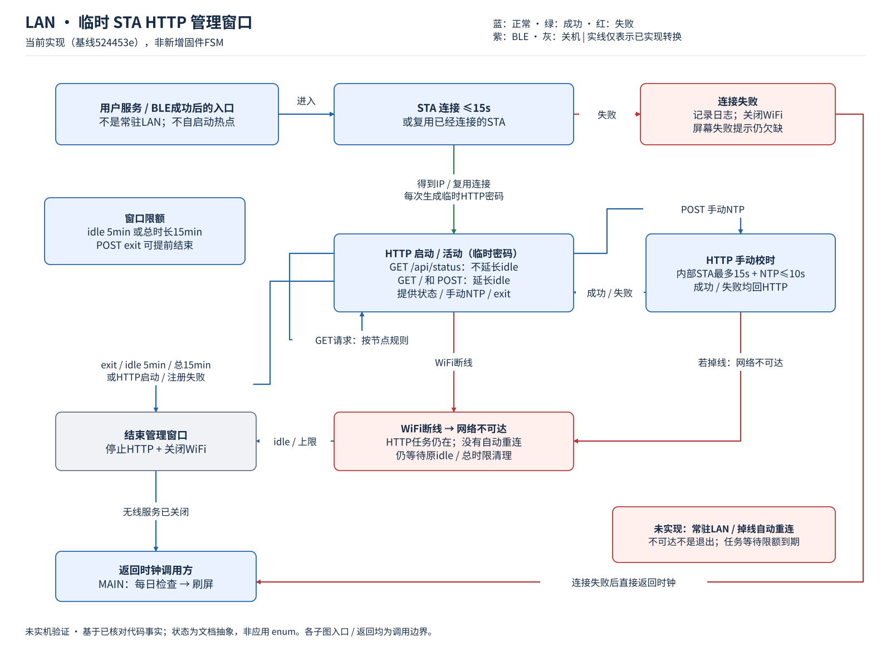
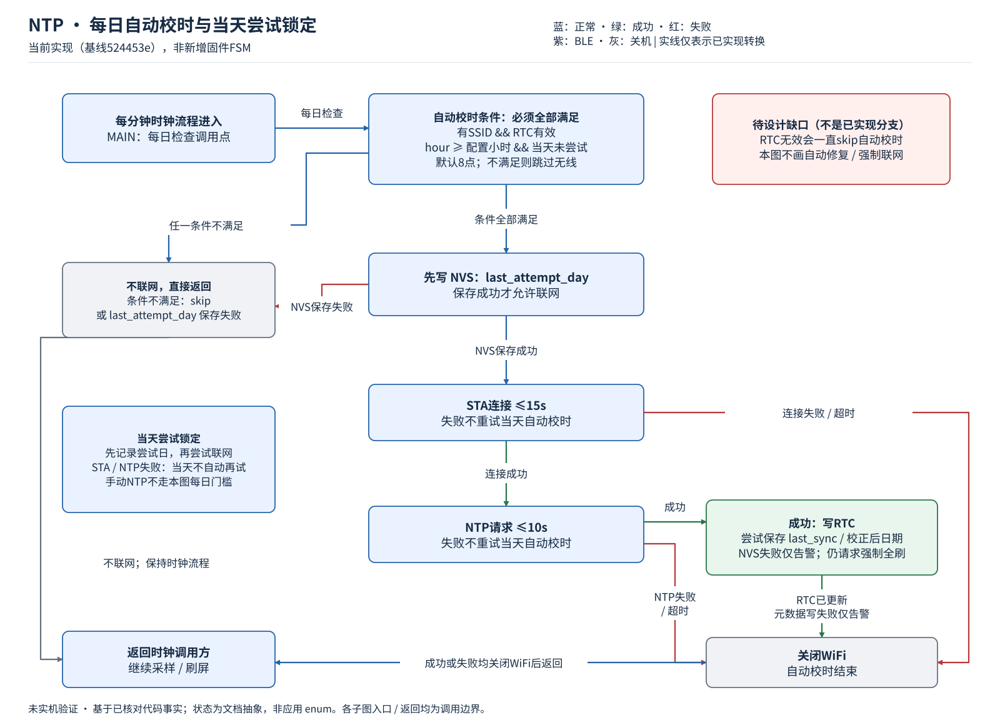

# 时钟、配网与供电状态机

分析基线：`524453e`（固件逻辑为已编译的 `d4cefd5`）。本文只梳理当前实现，**没有修改固件行为，也不是实机验收结论**。

代码尚无集中式 `enum state` / 事件分派器；下列状态名是对 `app_main()`、`run_management()`、`provision_run()`、`admin_run()` 和网络函数的抽象。BLE 协议内部状态由 ESP-IDF 管理，不能和网页自身的状态混为一谈。

- [主状态机](#1-主状态机)
- [BLE 配网子状态机](#2-ble-配网子状态机)
- [LAN 管理子状态机](#3-lan-管理子状态机)
- [每日校时子状态机](#4-每日校时子状态机)
- [屏幕供电与整机供电](#5-屏幕供电与整机供电)
- [梳理出的缺口](#6-梳理出的缺口与后续设计)

图中的实线表示当前转换。保存成功、网络连通、服务存活和电源状态是不同概念，不能合并成一个“已连接”状态。

## 1. 主状态机



[PNG](diagrams/main.png) · [可编辑 draw.io（四页）](diagrams/state-machines.drawio)

| 当前状态 | 事件 / 条件 | 动作与下一状态 |
| --- | --- | --- |
| 初始化 | USB 有电 | 额外开放最多 10 秒串口校时窗口，然后选择启动路径 |
| 选择启动路径 | RTC AF 未置位，或检测到中键 / 上键 | 进入用户服务；“非 RTC 启动”是代码判据，不是另行识别了 PWR 按键来源 |
| 选择启动路径 | RTC 定时启动且未触发按键 | 进入每日校时检查，不因没有 SSID 就每分钟强制开启 BLE |
| 用户服务 | 上键请求，或没有保存的 SSID | BLE 配网；只有保存成功才继续尝试 NTP、再开启 LAN 管理 |
| 用户服务 | 已保存 SSID，且没有上键请求 | 直接尝试 LAN 管理；Wi-Fi 失败不会自动进入 BLE |
| 用户服务 | BLE 未成功保存，或 LAN 退出 / 失败 | 返回正常更新路径，检查每日校时后采样、刷屏、保存缓存 |
| 刷屏结束 | 刷新跨过了整分钟 | 立即再执行更新，避免漏掉新一分钟 |
| 刷屏结束 | 电池模式 | 设置下一分钟 RTC 闹钟，再执行 PMU 整机关机；RTC / PWR 上电后冷启动 |
| 刷屏结束 | USB 模式 | 保持主控运行，等待整分钟；每 50 ms 检查拨轮，按键进入用户服务 |

**USB 模式主控仍运行，不代表 LAN 常驻。**用户服务结束后 Wi-Fi / HTTP 仍会关闭；USB 等待阶段也没有 BLE。

按键只在主流程指定的检查点采样。BLE / HTTP 是阻塞式子流程，不能把“USB 时钟模式下按上键进入配网”理解成“任意状态下上键都能打断当前服务”。

源码：[main.c：run_management / app_main](../main/main.c)。

## 2. BLE 配网子状态机



[PNG](diagrams/ble.png)

| 阶段 | 事件 / 条件 | 动作与下一状态 |
| --- | --- | --- |
| 准备 | 分配帧、准备 Wi-Fi、生成设备名成功 | 生成本次 6 位数字 PoP，显示配网信息，启动 BLE + Security1 |
| 等待凭据 | PoP 验证失败 / 尚未提交 Wi-Fi | 不验证候选 Wi-Fi；保持在当前会话预算内等待 |
| 候选 Wi-Fi 连接 | 收到凭据 | 候选仅用于验证；ESP-IDF 配置有限次连接尝试，不替换应用保存配置 |
| 候选 Wi-Fi 连接 | 连接失败且未确认成功 | 清除候选有效标记；主循环复位 SDK 失败状态，允许同一 BLE 会话重新提交 |
| 候选 Wi-Fi 连接 | 取得 IP、候选有效且未过 deadline | 锁存 `verified` 和 `success=true`；**此时还没有保存到应用 NVS** |
| 已获 IP 验证 | SDK END，或活动 deadline 到达 | 拆卸 BLE manager，清理 SDK Wi-Fi 持久化，再尝试保存应用配置 |
| 未获 IP 验证 | 超时 / 不可恢复错误 | 清理资源，不写新应用配置，返回时钟路径 |
| 收尾 | 清理成功且已锁存 `success` | 调用 `network_save_config(verified)`；返回成功才表示应用保存成功 |
| 返回成功 | 应用 NVS 保存成功 | 尝试 NTP；不论 NTP 成败，再尝试 LAN 管理 |
| 返回失败 | 未验证，或清理 / 保存失败 | 返回时钟路径；失败不会自动重启新一轮 BLE |

### 几个容易误解的边界

1. **拿到 IP ≠ 已保存。**网页只能从 SDK 查询连接状态，没有专门的“应用 NVS 已提交”确认接口。最终仍需看设备后续画面。
2. **网页断开 ≠ 取消。**关闭页面或断开 GATT，不会撤销已经提交的凭据。设备仍可能取得 IP 并保存。
3. **超时 ≠ 必然回滚。**若 deadline 前已经取得 IP 并锁存 `success`，之后到时退出仍会走收尾、尝试保存；只有尚未验证成功时的超时才跳过保存。
4. 成功是锁存结果，**不是实时网络连接状态**。确认成功后再掉线，不会抹除 `verified`，也不会因此阻止后续保存。
5. 活动 deadline 从函数进入开始计算，为 295 秒；另外预留 5 秒做清理。初始化、屏幕刷新也占用预算；阻塞拆卸不是“第 300 秒一定强制结束”的保证。
6. SDK 连接次数配置为 3，但其计数跨失败复位累计；不能宣称每次重新提交都重新获得 3 次尝试。

应用保存配置在 `clock_net`，与 SDK 的 Wi-Fi 持久化分开。收尾会先清除 SDK 临时持久化，再写入通过验证的新配置；连接失败不会调用应用保存。**不要将这说成对写 NVS 中途断电、Flash 故障也已验证过的完整事务回滚保证。**

源码：[provision.c](../main/provision.c)、[network.c：network_save_config](../main/network.c)、[app.mjs](app.mjs)。

## 3. LAN 管理子状态机



[PNG](diagrams/lan.png)

| 阶段 | 事件 / 条件 | 动作与下一状态 |
| --- | --- | --- |
| STA 连接 | 没有现成连接 | 最多等待 15 秒，包括关联 / DHCP；失败则关闭无线并返回时钟 |
| STA 已连接 | 取得 IP / 复用连接 | 生成本次临时 HTTP 密码，屏幕显示地址及登录信息，启动 HTTP |
| HTTP 在线 | `GET /` 或合法操作 `POST` | 更新闲置计时；状态查询 `GET /api/status` **不会**续期 |
| HTTP 在线 | `POST /api/sync` | 同步调用联网校时；成功 / 失败通过 HTTP 响应返回，不因此自动关闭整个管理会话 |
| HTTP 在线 | Wi-Fi 断线 / IP 丢失 | 仅更新网络状态位；HTTP 任务还在，但 LAN 不可达；没有自动重连 |
| HTTP 会话 | 退出，或闲置 5 分钟，或总计 15 分钟 | 停 HTTP、停 Wi-Fi，返回正常时钟路径 |

总计 15 分钟从进入 `admin_run()` 开始计算，包含连接和屏幕准备时间；闲置计时在启动 HTTP 后重新设置。定时退出也需要等待正在执行的同步操作等返回，不是独立的强制断电定时器。

当前 HTTP 密码仍是**每次管理会话新生成的 16 位十六进制字符串**；这与已经改成 6 位数字的 BLE PoP 是两套凭据。当前实现既不是固定登录凭据，也不是保持可访问的长期 LAN 服务。

失败时屏幕缺少明确的错误 / 恢复入口提示；代码主要记录日志。管理期间掉线也没有独立恢复状态。

源码：[admin.c：handle / admin_run](../main/admin.c)、[network.c：on_event / network_start_management](../main/network.c)。

## 4. 每日校时子状态机



[PNG](diagrams/ntp.png)

自动尝试的条件是：

```text
SSID 已保存
且 RTC 有效
且本地小时 >= 配置时间（默认 08:00）
且今天尚未尝试
```

| 阶段 | 事件 / 条件 | 动作与下一状态 |
| --- | --- | --- |
| 条件检查 | 任一条件不满足 | 直接返回，不开启无线 |
| 记录今日尝试 | 持久化成功 | 开始 STA 连接 |
| 记录今日尝试 | 持久化失败 | 不进行本次联网，返回 |
| STA 连接 | 15 秒内失败 / 超时 | 关闭无线，返回；当天不自动再试 |
| STA 连接 | 成功 | 等待新的 NTP 响应，最多 10 秒 |
| NTP 等待 | 失败 / 超时 / 时间不可表示 | 关闭无线，返回；保留 RTC 时间 |
| NTP 等待 | 成功 | 写 RTC，更新成功时间及校正后的日期，关闭无线；调用方强制全刷 |

这是一日一次的节能策略，不是断网恢复策略。每日失败不会妨碍 RTC 继续走时；但 **RTC 本来就无效时，这条自动路径会始终跳过**。若首次配网后 NTP 又失败，不能宣称此后一定会自动恢复准确时间，目前还需要手动校时或 USB 校时。

源码：[network.c：network_daily_sync / network_sync_now / connect_station](../main/network.c)。

## 5. 屏幕供电与整机供电

**屏幕断电与 ESP32 关机是两层独立状态。**墨水屏刷新后不需要持续供电来保持当前图像；运行 LAN 不要求屏幕电源常开。

按官方示例的板级映射，当前屏幕电源为 PMU **ALDO3，配置 3.3V**：

```text
EPD_Init()
  → 开启 ALDO3 → 复位、初始化屏幕
  → 写帧与刷新 → 等待屏幕空闲
EPD_Sleep()
  → 发送屏幕休眠命令 → 拉低相关控制引脚 → 关闭 ALDO3
  → 画面保留；ESP32 是否继续运行由主流程决定
```

| 系统阶段 | 屏幕 ALDO3 | ESP32 / 网络 |
| --- | --- | --- |
| 刷新时钟 / 显示 BLE 或 LAN 信息 | 刷新期间开启，完成后关闭 | 主控运行；无线按所属业务状态决定 |
| 等待 BLE 配网 / HTTP 管理 | 关闭，保留刚显示的画面 | BLE / STA 及对应服务在预算内运行 |
| USB 时钟等待下一分钟 | 关闭，保留时钟画面 | 主控运行；当前实现无线和 HTTP 已关闭 |
| 电池 PMU 关机 | 关闭，保留时钟画面 | 主控及无线关闭，等待 RTC / PWR 再次上电 |
| 未来常驻 LAN（尚未实现） | 仍可只在刷新时开启 | 必须保留 ESP32 和 Wi-Fi 所需供电，耗电不能等同于 PMU 关机 |

`EPD_Sleep()` 在正常刷新路径中既让屏幕休眠，也断开 ALDO3；`axp_pwr_off()` 才执行 PMU 整机关机。不能用“墨水屏已断电”推断“网页也一定离线”，也不能用“网页在线”推断“屏幕一直通电”。

目前沿用官方电压和充电设置。官方文档称 PMU 为 TG28，示例使用 AXP2101 接口；这里说明的是驱动映射，不是已经完成实物电源轨 / 静态电流验证。没有实测前，不随意关闭其他电源轨或承诺续航。

源码：[epaper_port.c：EPD_Init / EPD_Sleep](../components/epaper_port/epaper_port.c)、[axp_prot.cpp：axp_init / axp_pwr_off](../components/axpPower/axp_prot.cpp)。官方入口：[板卡文档](https://docs.waveshare.net/ESP32-S3-ePaper-3.97)。

## 6. 梳理出的缺口与后续设计

以下是**待设计 / 待实现项**，不是图中已经具备的状态转换。

| 缺口 | 当前影响 | 最小改动方向 |
| --- | --- | --- |
| 常驻 LAN 尚未实现 | USB 模式也不能随时打开网页 | 先确定 USB / 电池各自策略；把网络服务生命周期从临时 `admin_run()` 中分离，不改屏幕按需供电 |
| LAN 掉线无恢复 | HTTP 任务存活但无法访问 | 增加“离线 → 有间隔的重连 → 恢复 / 失败提示”，并与电源策略区分，避免电池无限重试 |
| 连接失败缺少屏幕反馈 | 看不出失败还是没响应 | 明确显示连接中、失败及如何重新 BLE 配网 |
| RTC 无效时缺少自动校时恢复 | 首次 NTP 失败后可能长期没有有效时间 | 增加不依赖有效日期的有限恢复路径；不要复用“每天一次”的日期判断 |
| 网页没有应用保存确认 | 用户拿到 IP 后仍不知道 NVS 是否已提交 | 区分“凭据接受 / IP 验证 / 保存完成”；设计最终确认时要处理拆卸 BLE 与确认通知的先后 |
| LAN 登录凭据每次变化且较长 | 不适合后续直接访问 | 配合常驻 LAN 一起确定登录方式，不把 BLE 六位码当成已经解决了 HTTP 登录体验 |
| 无集中状态转移入口 | 错误退出、计时和恢复逻辑分散 | 先确定目标转换；需要改行为时再引入最小状态枚举，不为画图先重写所有模块 |

建议的设计边界是三层，而不是一个含糊的“开机 / 休眠”开关：

1. **系统供电**：USB 常运行 / 电池 PMU 关机策略。
2. **网络业务**：无线关闭、BLE 配网、STA 连接、LAN 在线、LAN 离线重连。
3. **显示供电**：刷新时开启 ALDO3，完成后关闭并保留图像。

这样才能在明确功耗取舍的前提下，实现“屏幕大部分时间断电，但 LAN 网页仍可访问”。具体 USB / 电池是否都常驻 LAN 尚需确定；本次只补图和说明，没有顺带修改此策略。

## 图的维护

源数据和生成器：[`tools/render_state_diagrams.py`](../tools/render_state_diagrams.py)。运行：

```sh
python3 tools/render_state_diagrams.py
```

生成四张 SVG 和多页 `state-machines.drawio`；PNG 是同版 SVG 的浏览器渲染快照。生成后检查文字、箭头、节点，以及本文和固件的对应关系。改文档无需重新构建或烧录固件。
